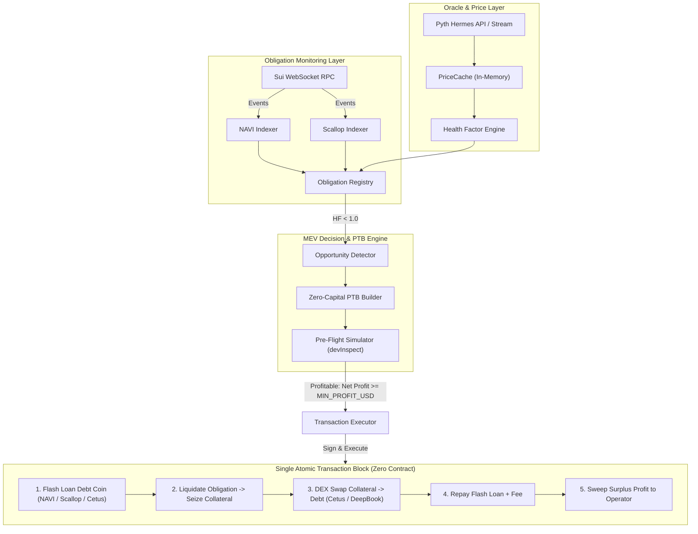
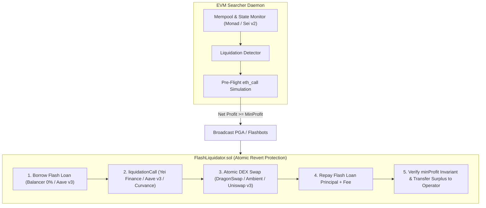

# ⚡ SuiMEV & EVM-MEV Zero-Capital Liquidation Engine

[]()
[]()
[]()
[]()
[]()

> **Production-grade, Zero-Capital MEV Liquidation Engine across Sui Blockchain and High-Performance Parallel EVM Networks (Monad & Sei v2).**
>
> On **Sui**, it monitors borrower obligations across **NAVI Protocol** and **Scallop Protocol**, tracks sub-second Pyth oracle price streams, constructs zero-contract **Programmable Transaction Blocks (PTBs)** combining Flash Loans with concentrated DEX Swaps (**Cetus CLMM** & **DeepBook v3**), simulates transactions pre-flight, streams telemetry to a standalone **Dart CLI Dashboard**, and executes profitable liquidations atomically.
>
> In **`evm-mev/`**, it deploys and orchestrates atomic zero-capital liquidations on parallel EVM chains (**Monad** & **Sei v2**) using `FlashLiquidator.sol`, leveraging Balancer Vault (0% fee) and Aave v3 flash loans.

---

## 🌟 Key Features

### 1. Sui Zero-Contract Architecture
* **Zero-Contract Execution:** Native Sui **Programmable Transaction Blocks (PTB)** chain flash loans, protocol liquidations, and DEX swaps in a single transaction without deploying or maintaining custom smart contracts.
* **Dual Lending Protocol Coverage:** Full support for both **NAVI Protocol** and **Scallop Protocol** obligation models, dynamic borrow indices, collateral pools, and close factor management.
  * **NAVI:** 35% close factor cap enforcement and transient `Balance<T>` to `Coin<T>` consumption (`0x2::coin::from_balance`) preventing Move `dropmiss` aborts.
  * **Scallop:** Whole-obligation Pyth oracle updates (Abort 1025 guard), on-chain `riskLevel >= 1.0` liquidatability checks (Abort 2 guard), and dynamic token name resolution.
* **Multi-DEX Atomic Routing:** Atomic liquidation swaps via **Cetus CLMM** (33 verified on-chain canonical pools with automated slippage clamping) and **DeepBook v3** (CLOB spot swaps) with strict minimum output slippage protection.
* **Comprehensive 27-Token Coverage:** Full support for SUI, USDC, WUSDC, USDT, WUSDT, WETH, sbETH, SOL, FDUSD, WBTC, WWBTC, sbWBTC, HBTC, xBTC, LBTC, CETUS, NAVI/NAVX, SCA, HASUI, DEEP, WAL, USDY, USDSUI, CERT/vSUI, AFSUI (with dynamic SUI redemption pricing), BUCK, AUSD, NS, stSUI, BLUB, FUD, IKA, and SCA_SUI.
* **Sub-Millisecond Math Engine:** Evaluates multi-asset portfolios and risk-adjusted collateral thresholds at **~390,000 evaluations/sec** (`0.0025 ms` per evaluation).
* **High-Throughput PTB Assembler:** Builds multi-command atomic transaction blocks in **`~0.30 ms`** (`>3,300 PTBs/sec`).
* **Pyth Hermes Oracle Stream:** Real-time Pyth price tracking with on-chain PriceInfo object mapping and volatility delta tracking on volatile collaterals (e.g., BTC/hBTC rapid drops triggering cascade sweeps).
* **Pre-Flight Simulation Guard:** Runs `devInspectTransactionBlock` before consensus broadcast, calculating net profit in USD ($P_{\text{net}} = P_{\text{gross}} - \text{GasCost}_{\text{USD}}$) and discarding unprofitable opportunities.
* **Zero-Capital Solvency & Bad Debt Guard:** Prevents gas waste by automatically detecting and discarding unexecutable historical bad debt ($0 collateral).
* **Resilient Multi-RPC Routing:** Routes all production requests through low-latency dedicated endpoints (Alchemy Sui Mainnet, NodeInfra, Sui RPC Pool) with automatic failover and rate-limit backoff.
* **High-Performance Dart Telemetry Dashboard:** Standalone Dart terminal dashboard (`dashboard_cli/`) reading atomic, lock-free telemetry snapshots from `src/engine/telemetryBridge.ts` with ANSI formatting, watchlist tables, financial cards, and keyboard controls.

### 2. EVM Zero-Capital Engine (`evm-mev/`)
* **Parallel EVM Optimized:** Built specifically for parallel execution environments (**Monad** & **Sei Network v2**).
* **FlashLiquidator Contract:** Deploys `FlashLiquidator.sol` orchestrating Balancer Vault (0% fee flash loans) and Aave v3 with atomic revert protection (`minProfit` invariant enforcement).
* **Multi-DEX Swaps:** Integrates DragonSwap, Ambient, and Uniswap v3 for atomic collateral liquidation routing.

### 3. Security & Dependency Hardening
* **Zero Secrets Committed:** Complete compliance with strict MEV security guidelines — zero private keys, API tokens, or hardcoded addresses in git history.
* **Move SDK Compatibility:** Pinned package overrides ensure seamless operation of Move Sui v2 SDK packages (`@scallop-io/sui-scallop-sdk`, `@cetusprotocol/cetus-sui-clmm-sdk`).
* **Exhaustive Test Suite:** 271 Vitest TypeScript automated tests and 98 Dart adversarial stress tests passing covering math, PTBs, oracles, routers, devInspect simulation, high concurrency, and real-world liquidations.

---

## 📐 System Architecture

### Sui Atomic PTB Flow



### EVM Flash Liquidator Flow (`evm-mev/`)



---

## 🔄 The Zero-Capital Atomic PTB Flow (Sui)

On Sui, PTBs natively allow composing Move calls across completely separate packages in a single execution:

```text
┌────────────────────────────────────────────────────────────────────────┐
│                      Programmable Transaction Block                    │
├────────────────────────────────────────────────────────────────────────┤
│ 1. Borrow Flash Loan:                                                  │
│    borrow_flash_loan(Market, DebtAmount) -> (LoanCoin, Receipt)        │
│                                                                        │
│ 2. Liquidate Obligation:                                               │
│    liquidate(Obligation, LoanCoin, DebtAssetId, ColAssetId)            │
│    -> Seizes CollateralCoin (with 5-8% liquidation bonus)              │
│                                                                        │
│ 3. DEX Swap (Collateral -> Debt Asset):                                │
│    cetus_clmm::pool_v2::swap(CollateralCoin) -> SwappedDebtCoin        │
│                                                                        │
│ 4. Split Repayment Coin:                                               │
│    splitCoins(SwappedDebtCoin, [DebtAmount + FlashLoanFee])            │
│    -> (RepayCoin, ProfitCoin)                                          │
│                                                                        │
│ 5. Repay Flash Loan:                                                   │
│    repay_flash_loan(Market, Receipt, RepayCoin)                        │
│                                                                        │
│ 6. Sweep Net Profit:                                                   │
│    transferObjects([ProfitCoin], OperatorAddress)                      │
└────────────────────────────────────────────────────────────────────────┘
```

> **Atomic Safety Guarantee:** If DEX liquidity is insufficient, slippage exceeds the threshold, or another searcher liquidates first, the Move execution aborts automatically and the entire PTB rolls back. Zero operator capital is at risk.

---

## 🚀 Quick Start (Sui Engine)

### 1. Prerequisites

* **Node.js 22.x or 24.x** (compatible with Vitest 5 and Sui SDK v2)
* **npm** or **pnpm**

### 2. Installation

```bash
git clone https://github.com/Disseveru/suimev.git
cd suimev
npm install
```

### 3. Configure Environment

Copy `.env.example` to `.env`:

```bash
cp .env.example .env
```

Edit your `.env` with your dedicated RPC endpoints and operator credentials:

```ini
# Mainnet Configuration
NETWORK=mainnet
SUI_RPC_URL=https://sui-mainnet.g.alchemy.com/v2/your_alchemy_key
SUI_BACKUP_RPCS=https://sui-mainnet.nodeinfra.com,https://mainnet.sui.rpcpool.com
SUI_WS_URL=wss://sui-mainnet.g.alchemy.com/v2/your_alchemy_key

# Operator Private Key (bech32 'suiprivkey1...')
SUI_PRIVATE_KEY=suiprivkey1...

# Pyth API Key (REQUIRED for live Hermes access as of August 2026, obtain via terminal.pyth.network)
# WARNING: Without this key, Pyth price updates will fail and liquidations will degrade or fail entirely.
PYTH_API_KEY=your_pyth_api_key_here

# Safety Mode: Set to 'false' only when ready for live execution
DRY_RUN=true

# Strategy Settings
MIN_PROFIT_USD=5.00
MAX_SLIPPAGE_BPS=100
LIQUIDATION_CLOSE_FACTOR=0.50
PROTOCOLS=navi,scallop
PREFERRED_DEX=cetus
```

---

## 💻 CLI Commands (Sui)

### 1. Run Live Searcher Daemon

Starts event listeners, Pyth Hermes price feed updates, and the real-time terminal telemetry dashboard:

```bash
npm start
```

### 2. Scan Obligations Across Protocols

Performs an on-chain audit of borrower obligations across NAVI & Scallop and displays positions, health factors, and liquidation status:

```bash
npm run scan
```

### 3. Dry-Run Simulator Test

Builds and simulates an atomic zero-capital PTB against current RPC state:

```bash
npm run simulate
```

### 4. Run Latency Benchmarks

Benchmarks valuation math and PTB assembly throughput:

```bash
npm run benchmark
```

### 5. Sentio Move Debugger & Sui Replay Tools

Simulate and inspect PTBs visually with Sentio, or replay on-chain transactions:

```bash
# Check Sentio configuration and simulation link
npm run sentio

# Replay and inspect any on-chain transaction or failed liquidation
npm run replay <TRANSACTION_DIGEST>
```

### 6. Standalone Dart Terminal Dashboard

Launch the real-time, interactive terminal monitoring UI with live watchlist, operator gas tank, and financial metrics:

```bash
# Continuous real-time mode (1s auto-refresh)
dart run dashboard_cli/bin/dashboard.dart

# Single-shot snapshot mode
dart run dashboard_cli/bin/dashboard.dart --once

# Or run tests on dashboard_cli
cd dashboard_cli && dart test
```

### 7. On-Chain Verification Scripts

Verify protocol bytecode ABIs and canonical Cetus CLMM pool registrations directly against Sui Mainnet RPC:

```bash
# Verify NAVI, Scallop, and Cetus Move bytecode signatures
npx tsx scripts/verifyBytecodeSignatures.ts

# Verify all 33 canonical Cetus pools on-chain
npx tsx scripts/verifyPools.ts
```

### 8. Run Automated Test Suite

Executes all 271 unit, integration, and adversarial stress tests across TypeScript and Move simulation:

```bash
# TypeScript Vitest Suite (271 tests across 24 suites)
npm test

# Run tests in watch mode
npm run test:watch
```

---

## ⚡ Quick Start (EVM Engine - `evm-mev/`)

Navigate to the EVM sub-project:

```bash
cd evm-mev
npm install
```

### 1. Check Network Status (Monad / Sei v2)

```bash
npm run status
```

### 2. Pre-Flight Zero-Capital Simulation

```bash
npm run simulate
```

### 3. Run EVM Test Suite

```bash
npm test
```

---

## 📊 Benchmark Performance

Measured on Node.js v26.7.0 (AMD Ryzen 9 / Intel Core i9 class processor):

| Operation | Latency (ms) | Throughput (ops/sec) |
| :--- | :--- | :--- |
| **Health Factor Evaluation** | **`0.0025 ms`** | **~396,000 ops/sec** |
| **Zero-Capital PTB Assembly** | **`0.2994 ms`** | **~3,340 blocks/sec** |
| **Price Cache Lookup** | **`< 0.0001 ms`** | **> 10,000,000 ops/sec** |

---

## 📂 Repository Structure

```text
suimev/
├── src/                          # Sui MEV Liquidator Core
│   ├── config/                   # Zod env validation, 27 coin configs, shared objects
│   ├── client/                   # Multi-RPC client, WebSocket subscribers, gas manager
│   ├── oracles/                  # Price cache, Pyth Hermes stream, health factor engine
│   ├── protocols/                # NAVI, Scallop, and DEX (Cetus & DeepBook) routers
│   ├── engine/                   # PTB builder, registry, simulator, executor, telemetryBridge
│   ├── ui/                       # Real-time terminal telemetry dashboard & pino logger
│   └── cli/                      # CLI commands (start, scan, simulate, benchmark)
├── dashboard_cli/                # Standalone Dart Terminal Dashboard UI
│   ├── bin/                      # dashboard.dart executable entrypoint
│   ├── lib/src/                  # Models, poller, ANSI renderer, lifecycle controllers
│   └── test/                     # 98 Dart adversarial stress & renderer tests
├── scripts/                      # Operational & verification tools
│   ├── verifyBytecodeSignatures.ts # Verified Move normalized module bytecode signatures
│   ├── verifyPools.ts            # Batch verification of 33 canonical Cetus pools on-chain
│   └── transferSui.ts            # Parameterized SUI gas rebalancer
├── evm-mev/                      # Parallel EVM Liquidation Engine (Monad & Sei v2)
│   ├── contracts/                # FlashLiquidator.sol (Balancer / Aave v3 atomic liquidator)
│   ├── src/                      # EVM searcher daemon, ABI loaders, simulation
│   └── tests/                    # EVM liquidation & revert protection unit tests
├── tests/                        # 271 Sui unit, integration, and adversarial tests
├── dist/                         # Compiled production ESM build
├── .env.example                  # Environment configuration template
├── package.json
└── tsconfig.json
```

---

## 🛡️ Risk Management & Safety Features

1. **Dry-Run Mode Default:** `DRY_RUN=true` is enabled by default. The bot will simulate all transactions on RPC without broadcasting to consensus.
2. **Pre-Flight devInspect:** Every transaction is simulated against current state before submission. If another liquidator front-runs the transaction or prices shift, simulation fails and no gas is committed.
3. **Minimum Net Profit Gate:** A transaction is only submitted if $\text{Net Profit USD} \ge \text{MIN\_PROFIT\_USD}$ after deducting computation costs, storage fees, flash loan fees, and DEX slippage.
4. **Slippage Enforcement:** Atomic DEX swap calls specify strict minimum output amounts; if slippage exceeds `MAX_SLIPPAGE_BPS`, the Move call aborts atomically.
5. **Zero-Capital Solvency Guard:** Enforces `totalCollateralUsd > 0 && collaterals.length > 0` before building PTBs to eliminate failed transactions against bad debt positions.

---

## 📜 License

MIT
